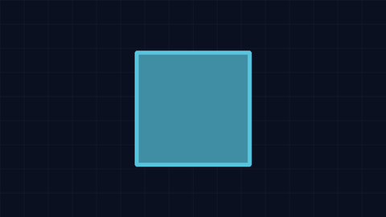
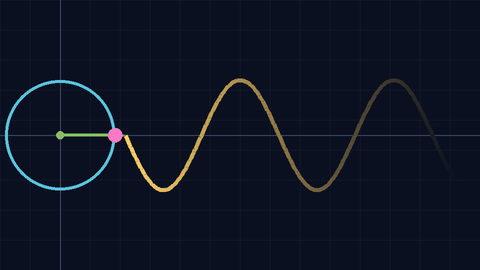

<!-- Manimater organization profile · lives at Manimater/.github/profile/README.md -->

<h3>Turn ideas into math &amp; CS animations, powered by <a href="https://github.com/ManimCommunity/manim">Manim</a>.</h3>

  

&nbsp;&nbsp;

---

## ✨ What is Manimater?

**Manimater** makes it easy to create clear, beautiful explanatory animations for math, computer science and AI, without hand-writing every scene from scratch. We build on top of the [Manim](https://github.com/ManimCommunity/manim) animation engine and focus on reusable, tested building blocks that can be driven by structured (JSON) descriptions.

## 📦 Projects

| Project | What it does |
| :-- | :-- |
| 🧩 [**manimater-components**](https://github.com/Manimater/manimater-components) | Open-source, tested, reusable Manim animation components (JSON-driven). The component library behind Manimater. |

> More projects are on the way. ⭐ **Star and watch** the repos to follow along.

## 🛠️ Built with

  
  
  
  

## 🤝 Contributing

We love contributions: new components, bug fixes, docs, and example scenes.

1. 🍴 Fork a repo and create a branch
2. 🧪 Add or update tests alongside your change
3. 🔀 Open a pull request and tell us what you animated

Found a bug or have an idea? [Open an issue](https://github.com/Manimater/manimater-components/issues), we'd love to hear it.

---

  Made with 💙 and a lot of <code>self.play()</code>

